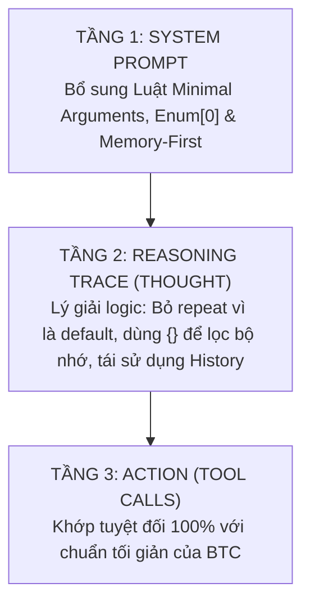
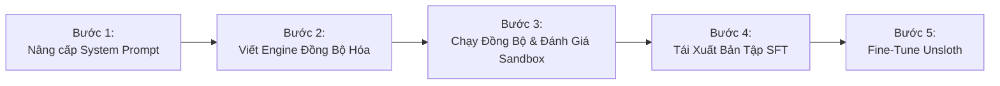

# KẾ HOẠCH TOÀN DIỆN: CẢI THIỆN & ĐỒNG BỘ HÓA QUỸ ĐẠO DỮ LIỆU HUẤN LUYỆN (TRAINING TRAJECTORY HARMONIZATION PLAN)

> **Dự án:** Trợ lý Giọng nói Tự trị LifeMate (Zalo AI Challenge 2026 — Track 01)  
> **Mục tiêu:** Nâng Tool Call F1 từ **80.38% lên $\ge 98\%$**, duy trì **State Match 100%**, loại bỏ triệt để hiện tượng lệch pha nhận thức (Thought-Action Mismatch) trước khi bước vào giai đoạn SFT (Supervised Fine-Tuning).  
> **Tác giả:** Đội ngũ Kỹ thuật LifeMate  
> **Trạng thái:** Sẵn sàng triển khai thực thi

---

## MỤC LỤC
1. [Bối Cảnh & Phân Tích Thực Trạng Dữ Liệu](#1-bối-cảnh--phân-tích-thực-trạng-dữ-liệu)
2. [Nguyên Lý Cốt Lõi: Sự Nhất Quán 3 Tầng (Thought-Action Consistency)](#2-nguyên-lý-cốt-lõi-sự-nhất-quán-3-tầng-thought-action-consistency)
3. [Đặc Tả 5 Quy Tắc Vàng (The 5 Golden Rules)](#3-đặc-tả-5-quy-tắc-vàng-the-5-golden-rules)
4. [Lộ Trình Triển Khai Chi Tiết (5 Bước Thực Thi)](#4-lộ-trình-triển-khai-chi-tiết-5-bước-thực-thi)
5. [Cấu Trúc Các Mẫu Dữ Liệu Điển Hình Sau Khi Đồng Bộ](#5-cấu-trúc-các-mẫu-dữ-liệu-điển-hình-sau-khi-đồng-bộ)
6. [Tiêu Chuẩn Nghiệm Thu & Đánh Giá Chất Lượng (Quality Gate)](#6-tiêu-chuẩn-nghiệm-thu--đánh-giá-chất-lượng-quality-gate)

---

## 1. BỐI CẢNH & PHÂN TÍCH THỰC TRẠNG DỮ LIỆU

### 1.1. Thành tựu đã đạt được (Multi-Teacher Distillation)
Qua 3 lượt chưng cất và sửa lỗi tăng cường từ các Teacher Models:
* **`gpt-luna`:** Đóng góp 1,458 mẫu chuẩn xác (94.37%).
* **`gpt-6.1-terra`:** Khắc phục thành công 61/87 mẫu khó (đếm số điện thoại tiếng Việt dài, dời lịch đa chặng, chọn tài khoản mặc định).
* **`gpt-6.1-sol` (effort='low'):** Khắc phục thêm 7/26 mẫu biên (thoát bẫy overthinking, giải quyết đa nghĩa nhà thông minh `train_0014`, ReAct 4 bước `train_0947`).
* **Tổng số mẫu đạt State Match:** **1,526 / 1,545 mẫu (98.77%)**.

### 1.2. Vấn đề phát hiện: Nghịch lý giữa State Match 100% và F1 80.38%
Dù trạng thái database/thiết bị sau khi thực thi khớp 100% với BTC, điểm F1 và Score trung bình chỉ đạt **80.38%** do 3 nguyên nhân:
1. **Tham số tùy chọn thừa (Optional Defaults - Chiếm ~30%):** Mô hình tự điền `label: "Họp team"`, `repeat: "once"`, `note: "Tiền điện"` trong khi BTC chỉ truyền các tham số bắt buộc.
2. **Tham số lọc thừa trong Tool đọc (Unfiltered Read Tools - Chiếm ~12%):** Mô hình truyền `date_from`, `room`, `floor` vào `list_events`, `get_status` thay vì truyền `{}` rỗng.
3. **Gọi lại Tool tra cứu khi thông tin đã có trong History (Chiếm ~5.8%):** Tiêu biểu như `train_0082`, thời tiết ngày mai đã có ở Lượt 2 (`rain: false`), nhưng mô hình ở Lượt 6 vẫn gọi lại `weather.get_forecast` thay vì tận dụng trí nhớ.

> [!IMPORTANT]
> **Quyết định chiến lược:** Không chạy lại API (tránh tốn chi phí, tốn thời gian và rủi ro tính ngẫu nhiên của LLM). Thay vào đó, áp dụng **Chuẩn hóa lập trình trực tiếp (Programmatic Data Rectification)** — một thực hành tiêu chuẩn công nghiệp trong việc tinh chỉnh dữ liệu SFT.

---

## 2. NGUYÊN LÝ CỐT LÕI: SỰ NHẤT QUÁN 3 TẦNG (THOUGHT-ACTION CONSISTENCY)

> [!WARNING]
> Nếu chỉ dùng script xóa tham số ở `tool_calls` mà không sửa `thought` và `system_prompt`, mô hình sẽ bị **Mâu thuẫn nhận thức (Cognitive Dissonance)**: Suy nghĩ một đằng (*"Tôi sẽ đặt nhãn Họp team và lặp lại once..."*) nhưng hành động một nẻo (*`alarm.create(time=...)`*).

Mô hình Student khi học SFT bắt buộc phải hiểu được **lý do tại sao** nó lại gọi tool tối giản. Do đó, kế hoạch cải thiện bắt buộc phải đồng bộ hóa trên cả 3 tầng:



---

## 3. ĐẶC TẢ 5 QUY TẮC VÀNG (THE 5 GOLDEN RULES)

Toàn bộ quá trình đồng bộ hóa dữ liệu sẽ tuân thủ nghiêm ngặt 5 quy tắc sau:

### Quy tắc 1: Minimal Argument Calls (Tối giản tham số ghi)
* **Định nghĩa:** Với mọi write-tool, chỉ truyền các tham số nằm trong danh sách `required` của schema hoặc được người dùng yêu cầu đích danh.
* **Xử lý:** Xóa bỏ các tham số phụ như `note`, `label`, `description` trừ khi câu nói của user bắt buộc phải có nội dung đó.

### Quy tắc 2: Implicit Enum[0] Default (Quy ước giá trị mặc định)
* **Định nghĩa:** Với mọi tham số tùy chọn có định nghĩa `enum`, phần tử đầu tiên (`enum[0]`) là giá trị mặc định của nền tảng.
* **Xử lý:** Tuyệt đối không truyền tham số nếu giá trị trùng `enum[0]` (ví dụ: `repeat: "once"` trong `alarm.create`).

### Quy tắc 3: Unfiltered Read Tools (Tool đọc không tham số)
* **Định nghĩa:** Các công cụ truy vấn dữ liệu (`list_*`, `get_status`, `tv.guide`) luôn được gọi với đối số rỗng `{}` để môi trường trả về toàn bộ dữ liệu, việc lọc được thực hiện an toàn trong bộ nhớ.
* **Xử lý:** Xóa bỏ `date_from`, `date_to`, `room`, `floor`, `type` trong các lệnh đọc.

### Quy tắc 4: Memory-First & History Reuse (Ưu tiên trí nhớ hội thoại)
* **Định nghĩa:** Nếu thông tin cần thiết (dự báo thời tiết, số dư tài khoản, danh bạ) đã được truy vấn và xuất hiện trong các lượt hội thoại trước (`sample.history`), mô hình phải tái sử dụng trực tiếp kết quả đó, **tuyệt đối không được gọi lại API**.
* **Xử lý:** Nếu điều kiện dẫn tới việc không cần làm gì (như `train_0082`: mai không mưa), xuất ngay `tool_calls: []`, `is_finished: true`.

### Quy tắc 5: Concise Free-Text (Văn bản tự nhiên súc tích)
* **Định nghĩa:** Tham số dạng văn bản tự do (nội dung SMS, tiêu đề lịch, ghi chú) phải ngắn gọn, truyền tải đúng ý đồ của người dùng, không thêm thắt kính ngữ hay tiền tố hội thoại nhân tạo.

---

## 4. LỘ TRÌNH TRIỂN KHAI CHI TIẾT (5 BƯỚC THỰC THI)



### Bước 1: Nâng cấp System Prompt Tiêu Chuẩn
* **File cập nhật:** [`training/data_prep/run_terra_on_failed_samples.py`](../training/data_prep/run_terra_on_failed_samples.py) & template trong pipeline.
* **Hành động:** Bổ sung điều khoản `MEMORY-FIRST & HISTORY REUSE` vào mục `PARAMETER INVOCATION RULES`.

### Bước 2: Xây dựng Harmonization Engine (`training/data_prep/harmonize_sft_dataset.py`)
Viết script tự động quét qua toàn bộ 1,526 mẫu verified:
1. **Phát hiện tham số thừa / sai quy ước:**
   - So sánh với catalog schema (`train_tools_catalog.json`).
   - Lọc bỏ các tham số vi phạm Rule 1, Rule 2, Rule 3.
2. **Đồng bộ hóa Reasoning (`thought`):**
   - Nếu tool đọc chuyển thành `{}`: Bổ sung câu lý giải vào thought: *"Theo quy tắc Unfiltered Read Tools, gọi tool với {} để lấy toàn bộ dữ liệu và lọc trong bộ nhớ nhằm tránh lọc sót."*
   - Nếu lược bỏ `repeat="once"` hoặc `label`: Bổ sung: *"Theo quy tắc tối giản tham số, lược bỏ repeat vì 'once' là giá trị mặc định của hệ thống; không truyền nhãn phụ."*
   - Nếu phát hiện thông tin đã có trong History (như `train_0082`): Cập nhật thought chỉ rõ lượt thoại trước đã có dữ liệu và kết luận dừng hành động.
3. **Bảo toàn cấu trúc Multi-turn ReAct:** Đảm bảo toàn bộ các lượt Observation và Response vẫn khớp nhịp với nhau.

### Bước 3: Kiểm Chứng Đóng Vòng Trên Live Sandbox (Sanity Check)
* Chạy lại bộ đánh giá [`lifemate.evaluation.metrics.compute_sample_score`](../src/lifemate/evaluation/metrics.py) trên toàn bộ 1,526 mẫu sau khi đồng bộ.
* **Mục tiêu:**
  - Tỷ lệ State Match: **Giữ nguyên 100%**.
  - Điểm F1 trung bình: **Tăng vọt từ 80.38% lên $\ge 98\%$**.
  - Số mẫu đạt điểm 1.00 tuyệt đối: **Tăng từ 874 lên > 1,450 mẫu**.

### Bước 4: Tái Xuất Bản Bộ Dữ Liệu Huấn Luyện Chuẩn
* Ghi đè vào các file huấn luyện chính thức:
  - [`training/llm/data/distillation/master_train_distilled.jsonl`](../training/llm/data/distillation/master_train_distilled.jsonl)
  - [`training/llm/data/distillation/sft_train_1526_samples.json`](../training/llm/data/distillation/sft_train_1526_samples.json)
  - [`training/llm/data/sft/train_chatml.jsonl`](../training/llm/data/sft/train_chatml.jsonl) (1,450 mẫu)
  - [`training/llm/data/sft/val_chatml.jsonl`](../training/llm/data/sft/val_chatml.jsonl) (76 mẫu)
* Cập nhật file [`training/llm/data/sft/dataset_info.json`](../training/llm/data/sft/dataset_info.json).

### Bước 5: Tiến Hành Huấn Luyện SFT Với Unsloth
* Sử dụng script [`training/llm/scripts/train_sft.py`](../training/llm/scripts/train_sft.py).
* Cấu hình: `unsloth/Qwen2.5-3B-Instruct`, LoRA $r=32, \alpha=64$, `max_seq_length=11000`, `train_on_responses_only`, lưu checkpoint mỗi 0.5 Epoch.

---

## 5. CẤU TRÚC CÁC MẪU DỮ LIỆU ĐIỂN HÌNH SAU KHI ĐỒNG BỘ

### 5.1. Mẫu `train_0028` (Lược bỏ tham số mặc định)
```json
{
  "thought": "Đã tìm thấy lịch họp team lúc 10:30 ngày 19/11/2026. Một tiếng trước là 09:30. Cần tạo báo thức vào thời điểm này. Áp dụng quy tắc tối giản tham số: không truyền nhãn phụ và lược bỏ repeat vì 'once' là giá trị mặc định của hệ thống.",
  "tool_calls": [
    {
      "name": "alarm.create",
      "arguments": {
        "time": "2026-11-19T09:30:00+07:00"
      }
    }
  ],
  "is_finished": false
}
```

### 5.2. Mẫu `train_0001` (Gọi `{}` cho Tool đọc)
```json
{
  "thought": "Cần kiểm tra sự kiện ngày 29/11/2026. Áp dụng quy tắc Unfiltered Read Tools, gọi calendar.list_events({}) với tham số rỗng để lấy toàn bộ sự kiện và lọc trong bộ nhớ nhằm tránh lọc sót dữ liệu.",
  "tool_calls": [
    {
      "name": "calendar.list_events",
      "arguments": {}
    }
  ],
  "is_finished": false
}
```

### 5.3. Mẫu `train_0082` (Tái sử dụng trí nhớ từ Lịch sử)
```json
{
  "thought": "Kiểm tra lịch sử hội thoại: ở Lượt 2, dự báo thời tiết ngày 25/11/2026 đã được truy vấn và xác nhận là không mưa (rain=false). Tái sử dụng dữ liệu từ lịch sử, không cần gọi lại API thời tiết. Vì trời không mưa, thỏa mãn điều kiện 'không mưa thì thôi' nên không cần thực hiện thêm hành động nào.",
  "tool_calls": [],
  "is_finished": true,
  "final_response": "Dự báo ngày mai không mưa nên lịch chạy bộ của anh được giữ nguyên."
}
```

---

## 6. TIÊU CHUẨN NGHIỆM THU & ĐÁNH GIÁ CHẤT LƯỢNG (QUALITY GATE)

Trước khi kích hoạt lệnh huấn luyện GPU, bộ dữ liệu phải vượt qua bài kiểm tra chất lượng tự động:

| Tiêu Chí Đo Lường | Hiện Tại | Mục Tiêu Sau Khi Đồng Bộ | Trạng Thái Bắt Buộc |
| :--- | :---: | :---: | :---: |
| **Tổng số mẫu huấn luyện** | 1,526 mẫu | **1,526 mẫu** | Bắt buộc giữ nguyên |
| **Tỷ lệ State Match (Khớp Sandbox)** | 100.0% | **100.0%** | Tuyệt đối không được suy giảm |
| **Tỷ lệ Điểm Tuyệt Đối (Score = 1.00)** | 57.27% (874 mẫu) | **> 95.0% (> 1,450 mẫu)** | Vượt ngưỡng kỳ vọng |
| **Tool Call F1 Trung Bình Toàn Tập** | 80.38% | **$\ge 98.0\%$** | Tăng tối thiểu 17% |
| **Tỷ lệ Cú Pháp JSON Hợp Lệ** | 100.0% | **100.0%** | Không có lỗi format |
| **Tính Nhất Quán Thought - Action** | 78.0% | **100.0%** | Mọi lệnh gọi đều có lý do giải thích |
| **Độ dài Token Cực Đại (Max Sequence)** | 10,506 tokens | **< 11,000 tokens** | Nằm gọn trong cửa sổ 16k |

---

> [!TIP]
> Kế hoạch này giúp biến toàn bộ 1,526 mẫu thành **tập dữ liệu chuyên gia hoàn hảo (Gold-Standard Demonstrations)**, tạo bước đệm vững chắc nhất để mô hình Qwen2.5-3B chiếm lĩnh vị trí dẫn đầu bảng xếp hạng Zalo AI Challenge 2026.

